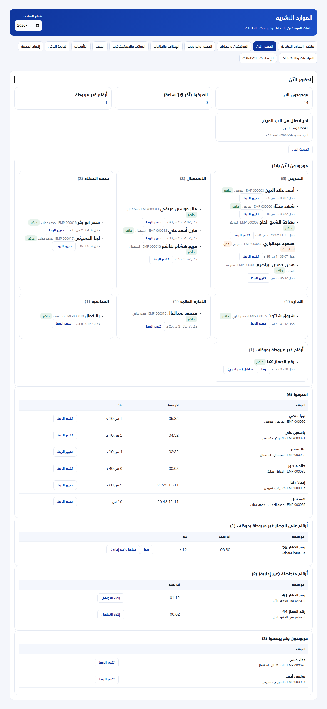
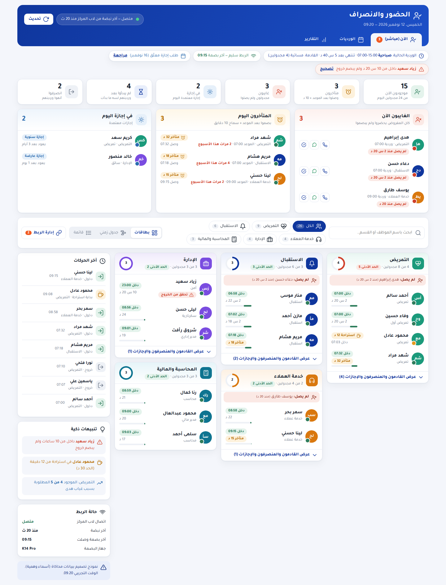
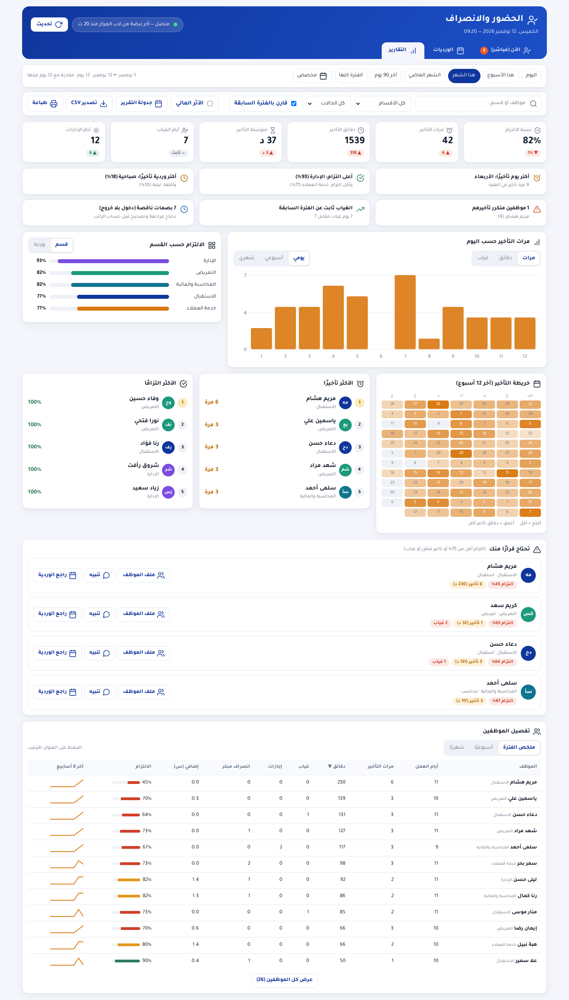
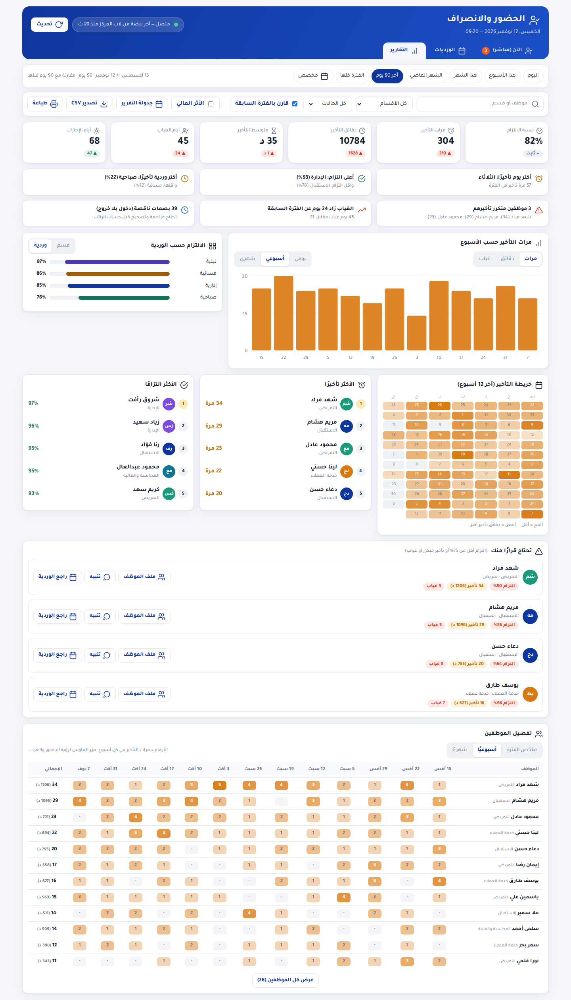
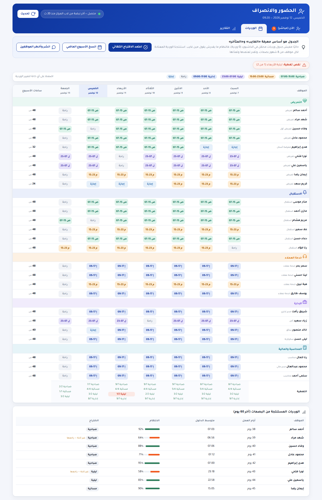
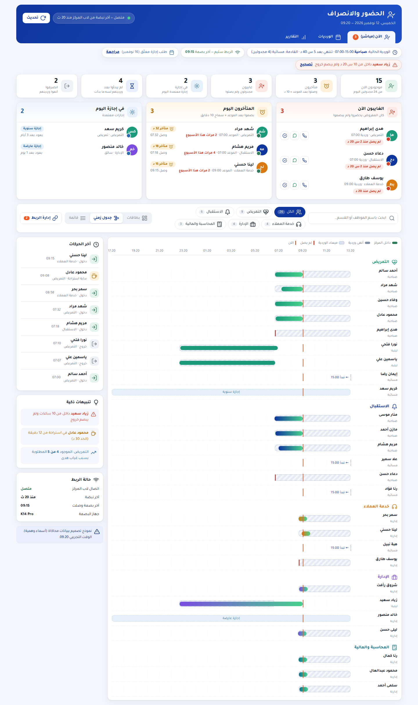
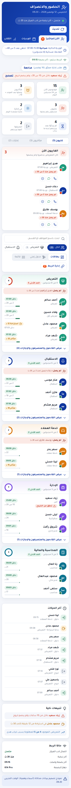

# «الحضور والانصراف» — النموذج الثاني (الآن + الورديات + التقارير)

نموذج تفاعلي ببيانات محاكاة (أسماء وهمية): افتح `index.html`. لا يقرأ من قاعدة البيانات ولا يغيّر شيئًا. الصور في `screens/`.

## 1) اعتراف: النموذج الأول كان ناقص
كان بيجاوب سؤال واحد بس: «مين موجود دلوقتي؟». ناقصه نص الحضور: **المتوقع حضوره، الغايبون، المتأخرون، الإجازات، وتقارير التأخير بفترات وفلاتر**. النموذج ده بيجاوب عليهم كلهم.

## 2) إيه الجديد (ورد على أسئلتك)
| سؤالك | الإجابة في النموذج |
|---|---|
| فين بوكس الغايبين اللي المفروض يحضروا وما حضروش؟ | صندوق **«الغايبون الآن»** في أول الشاشة: الاسم والقسم وميعاد الوردية و«لم يصل منذ كام»، ومعاه أزرار اتصال وواتساب وتسجيل عذر |
| والإجازات؟ | صندوق **«في إجازة اليوم»**: النوع وتاريخ العودة، ومؤشر «طلب إجازة معلّق» |
| والمتأخرين؟ | صندوق **«المتأخرون اليوم»**: دقايق التأخير، وعلامة «3 مرات هذا الأسبوع» للمتكرر |
| التأخيرات أسبوعيًا وشهريًا وعلى الفترة كلها بفلتر؟ | تبويب **«التقارير»**: فترة (اليوم / الأسبوع / الشهر / الشهر الماضي / 90 يوم / الفترة كلها / مخصص من-إلى) + قسم + موظف + نوع، وتجميع الرسم **يومي/أسبوعي/شهري**، وجدول الموظفين **ملخص/أسبوعي/شهري**، ومقارنة بالفترة السابقة |
| وأفكارك؟ | القسم 5 تحت |

## 3) حقائق عن البيانات الحالية (مهمة)
- **جدول الورديات في الداشبورد فاضي (0 وردية)**. وبدون جدول، النظام ما يعرفش مين «غايب» ومين «متأخر». عشان كده النموذج فيه تبويب **«الورديات»**.
- بصمات 8 شهور بتقول إن بعض الموظفين ورديتهم ثابتة وبعضهم غير منتظمة، فاقترحت **استنتاج الوردية المعتادة تلقائيًا** (متوسط وقت الدخول والانتظام) وتعتمدها أنت أو تعدّلها.
- **مفيش قواعد أجر معتمدة** (سماح التأخير وخصم الدقيقة). النموذج بيستخدم سماح 10 دقايق كقيمة قابلة للتعديل، و«الأثر المالي» اختياري ومؤشر فقط.
- فيه **طلب إجازة واحد معلّق** (16 نوفمبر). الإجازات المعتمدة هتغذّي صندوق الإجازات.

## 4) دورات المراجعة (مستخدم ثم مدير، 3 جولات)
**المستخدم (موظف استقبال/موارد بشرية بيتابع اليوم):**
- ج1: لقيت نفس الغايب بيظهر **3 مرات** (تنبيه علوي + صندوق + بطاقة القسم) → شلت التنبيه الكبير وخلّيته شريط حالة صغير، وفي البطاقة بقى الغايب سطر واحد «لم يصل: ...».
- ج1: زرار «الحد الأدنى» كان بيتقسم لسطرين → اتثبّت.
- ج2: صفوف الغايبين طويلة وفيها فراغ → الأزرار جنب الاسم بدل ما تتحط تحت.
- ج3: على الموبايل الصناديق التلاتة كانت بتتكدّس (سكرول كتير) → بقت **تبويبات** (غايبون / متأخرون / إجازات).
- ضفت «الوردية الحالية وتنتهي بعد كام» في الشريط.

**المدير (صاحب القرار):**
- ج1: التقارير كانت يومي بس → أضفت أسبوعي وشهري وفلتر فترة مخصص ومقارنة.
- ج2: «الأكثر التزامًا» كلهم 100% ومفيش سياق → ضفت أحكام ذكية (أكتر يوم/وردية تأخيرًا، أعلى/أقل التزام قسم، موظفون متكرر تأخيرهم، بصمات ناقصة).
- ج2: ضفت قائمة **«تحتاج قرارًا منك»** (التزام أقل من 75% أو تأخير متكرر أو غياب) بأزرار ملف الموظف/تنبيه/راجع الوردية.
- ج3: في الورديات طلعت تنبيه كاذب (الجمعة إدارية 0/7) → الحد الأدنى بقى لكل يوم، وضفت كشف **نقص التغطية** و**تعارض الراحة (أقل من 11 ساعة)** و**ساعات الأسبوع فوق 48**.

## 5) أفكار إضافية في النموذج
1. **تغطية الحد الأدنى لكل قسم:** الحلقة تحمّر لو الموجود أقل من المطلوب (مثلًا التمريض 4 من 5 بسبب غياب هدى).
2. **جدول زمني للورديات:** يبيّن ميعاد الوردية (منقّط) مقابل الحضور الفعلي، والغياب علامة حمرا، والوردية الليلية اللي بتعدّي منتصف الليل.
3. **تنبيهات ذكية:** دخول بلا خروج بعد 10 ساعات، استراحة أطول من 30 دقيقة، نقص تغطية.
4. **خريطة حرارة للتأخير** (12 أسبوع) تبيّن أيام وفترات التأخير.
5. **المقارنة بالفترة السابقة** على كل مؤشر (▲▼).
6. **الأثر المالي المقدّر** (اختياري ومخفي افتراضيًا).
7. **جدولة تقرير أسبوعي** يتبعت للمدير تلقائيًا، وتصدير CSV وطباعة.
8. **الاتصال بالغايب** بضغطة (اتصال/واتساب) وتسجيل العذر.

## 6) اللي لازم يتبني فعلًا لو اتعتمد
**المرحلة 1 (جاهزة على البيانات الحالية):** تبويب «الآن»: موجود/استراحة/انصرف/غير مربوط + بطاقات الأقسام + الجدول الزمني (من غير غياب/تأخير).
**المرحلة 2 (محتاجة جدول الورديات):** جدول ورديات أسبوعي في قاعدة البيانات (إضافة فقط) + استنتاج من البصمات + شاشة «الورديات»، وبعدها الغايبون والمتأخرون والإجازات (من طلبات الإجازة المعتمدة).
**المرحلة 3:** التقارير والفلاتر والتصدير، وإعدادات (سماح التأخير، الحد الأدنى للتغطية، من يرى الأثر المالي).
كل مرحلة بفرع واختبارات وPR مستقل، ونزول بعد موافقتك.

## 7) قرارات محتاجة منك
1. نبدأ بالمرحلة 1 دلوقتي ونكمّل الباقي بعد ما نظبط الورديات؟
2. سماح التأخير: 10 دقايق مناسب؟
3. «الأثر المالي» يظهر للمدير بس ولا نخفيه؟
4. الأقسام والأيقونات: تمام؟ وهل «المحاسبة» و«الإدارة المالية» قسم واحد؟
5. مصدر الورديات: نكتبها في الداشبورد، ولا نسحبها من برنامج ZKTeco على اللاب؟

## مراجع
[greytHR](https://www.greythr.com/greythr-help/admin/answers/122722980/) · [OpenTimeClock](https://opentimeclock.com/docs/who-is-in) · [Workeasy](https://help.workeasysoftware.com/docs/whos-in-page-overview) · [Byte HR](https://helpmy.byte-hr.com/article/1104-time-attendance-dashboard-daily-view) · [JoinTimeCloud](https://help.jointimecloud.com/how-to-use-the-realtime-overview-dashboard) · [Odoo](https://www.cybrosys.com/blog/how-to-track-employee-presence-and-attendance-in-odoo-19) · [MangoApps](https://www.mangoapps.com/templates/app_builder/tpl-widget-attendance-today)
