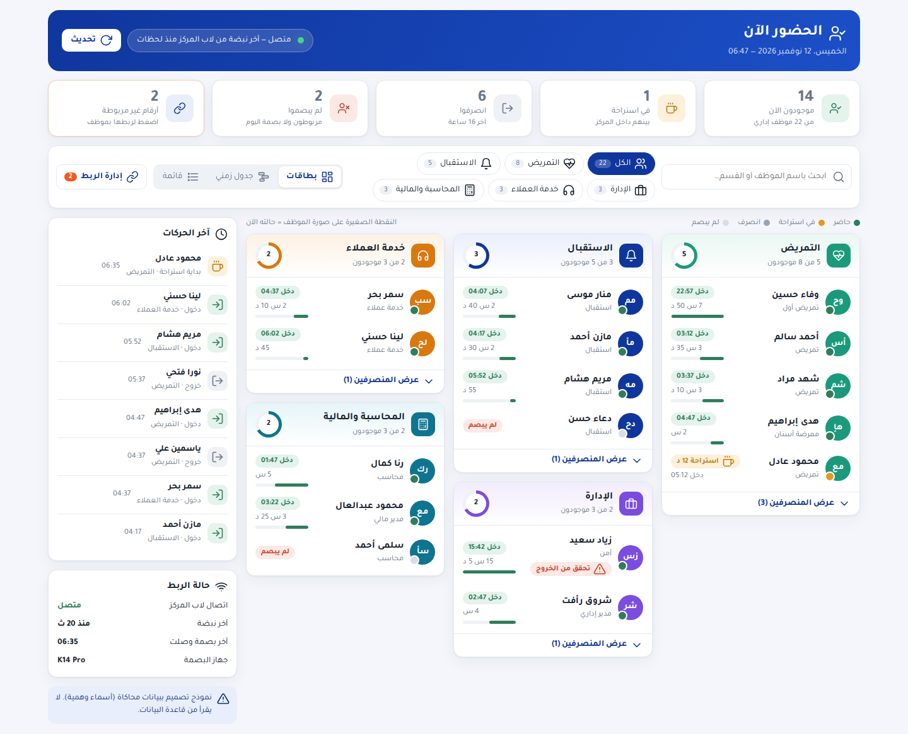
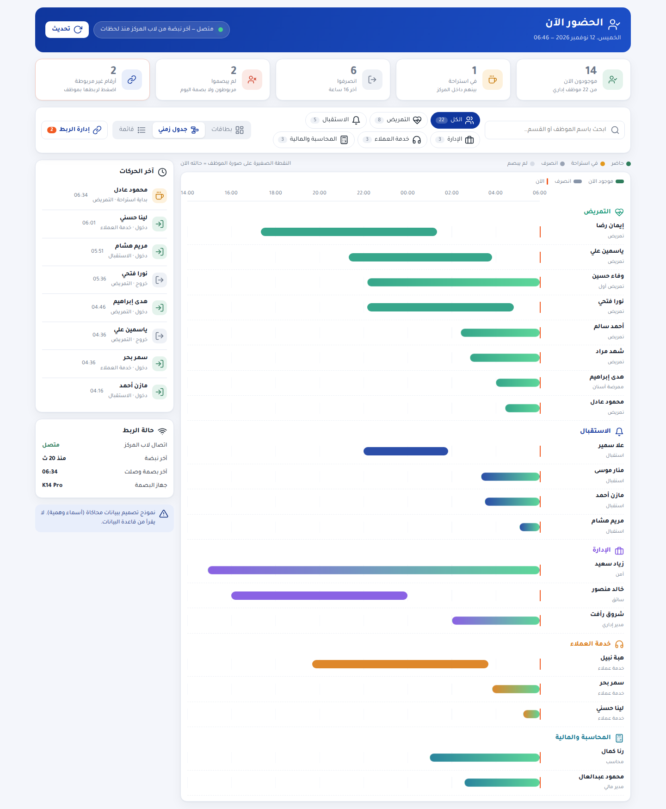
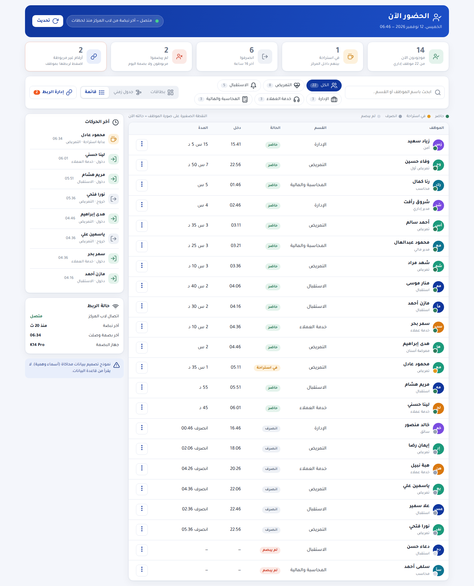
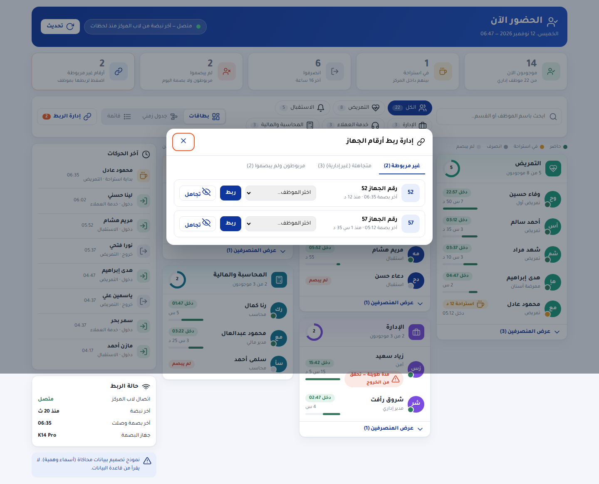
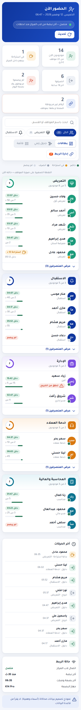

# «الحضور الآن» — تحليل الشاشة الحالية + نموذج التصميم الجديد

نموذج تفاعلي ببيانات محاكاة (أسماء وهمية): افتح `index.html`. لا يقرأ من قاعدة البيانات ولا يغيّر شيئًا.
الصور: `screens/` — الحالي (01) مقابل الجديد (02–07).

## 1) اللي لقيته في الشاشة الحالية (صورة 01)

| المشكلة | الأثر |
|---|---|
| الصفحة طويلة جدًا (حوالي 3100px بـ 21 شخص) | تمرير كتير، المعلومة الأهم (مين موجود) تضيع بين جداول |
| أربع كروت ملخص بأرقام صغيرة بلا أيقونات، والكارت الرابع نازل لسطر لوحده | فراغ كبير وشكل غير منظم |
| كروت الأقسام: الأسماء والحالة والمدة متكدسة، وشارة «حاضر» بتنزل لسطر لوحدها، وزرار «تغيير الربط» متكرر على كل شخص | ضوضاء بصرية |
| الجداول (انصرفوا / غير مربوطة / متجاهلة / لم يبصموا) ممتدة بعرض الصفحة وأعمدتها بعيدة عن بعض | فراغ عظيم وصعب التتبع |
| تفاصيل غير واضحة: «المدة» من غير ما نقول مدة إيه، تواريخ بصيغ مختلفة (`11-11 22:52`)، «آخر 16 ساعة»، «(غير إداري)»، «منذ الآن» | المستخدم يخمّن |
| مفيش بحث ولا فلتر ولا مؤشر لحالة كل شخص بالألوان | صعب تلاقي شخص أو قسم |
| مفيش أي حاجة تحكي الوردية (ليلية؟ صباحية؟) | مفيش سياق للمدة |

## 2) مراجع التصميم اللي اتفرجت عليها
أنماط متكررة في أنظمة «مين موجود» المعروفة، واستفدت منها:
- **كروت حالة بعدد ونسبة** (greytHR، Kenjo): ملخص يعطيك الصورة في ثانية. [greytHR](https://www.greythr.com/greythr-help/admin/answers/122722980/)
- **ملخص لكل قسم + فلتر قسم + جدول موظفين** (OpenTimeClock): [OpenTimeClock](https://opentimeclock.com/docs/who-is-in)
- **نموذج حالة بسيط بثلاث حالات** (Workeasy): شغال / غير شغال / غايب. [Workeasy](https://help.workeasysoftware.com/docs/whos-in-page-overview)
- **دائرة ملوّنة وضغطة على لون تفلتر الجدول** (Byte HR): [Byte HR](https://helpmy.byte-hr.com/article/1104-time-attendance-dashboard-daily-view)
- **نقطة حالة ملوّنة جنب كل شخص** (JoinTimeCloud، Odoo): [JoinTimeCloud](https://help.jointimecloud.com/how-to-use-the-realtime-overview-dashboard)، [Odoo](https://www.cybrosys.com/blog/how-to-track-employee-presence-and-attendance-in-odoo-19)
- **ويدجت لقطة صغيرة بدل صفحات** (MangoApps): [MangoApps](https://www.mangoapps.com/templates/app_builder/tpl-widget-attendance-today)

## 3) المقترح (صور 02–07)

**الفكرة:** شاشة واحدة، تقرأها في 5 ثواني: مؤشرات كبيرة فوق، فلاتر سريعة، المحتوى الأساسي كروت أقسام متراصّة، ولوحة جانبية لآخر الحركات وحالة الربط. أي حاجة تخص الإعداد (ربط/تجاهل) اتنقلت لنافذة «إدارة الربط» بدل ما تملا الصفحة.

| القسم | الأيقونة | المحتوى |
|---|---|---|
| الرأس | ✔👤 | عنوان + تاريخ ووقت + مؤشر اتصال حي (نقطة خضرا نابضة) + تحديث |
| المؤشرات الخمسة | ✔ ☕ ⇥ 👤✖ 🔗 | موجودون الآن (من X موظف) / في استراحة / انصرفوا / لم يبصموا / أرقام غير مربوطة. الضغط على أي مؤشر يفلتر |
| الفلاتر | 🔍 + أيقونة لكل قسم | بحث بالاسم + أزرار الأقسام بعدد كل قسم + تبديل العرض |
| التمريض | ❤️ نبض | كارت بدائرة تقدّم (5 من 8) |
| الاستقبال | 🔔 | " |
| الإدارة | 💼 | " |
| خدمة العملاء | 🎧 | " |
| المحاسبة والمالية | 🧮 | " |
| آخر الحركات | 🕒 | آخر 8 دخول/خروج/استراحة بالوقت والقسم |
| حالة الربط | 📶 | الاتصال، آخر نبضة، آخر بصمة، الجهاز |
| إدارة الربط | 🔗 | نافذة بثلاث تبويبات: غير مربوطة (ربط/تجاهل) / متجاهلة (إلغاء) / مربوطون ولم يبصموا |

**ثلاث طرق عرض لنفس البيانات** (تبديل من الشريط): **بطاقات** (المقترح الأساسي)، **جدول زمني** (شريط لكل موظف من الدخول لحد الآن، يبيّن الوردية الليلية اللي بتعدّي منتصف الليل بوضوح)، **قائمة مدمجة** (للي بيحب الجدول).

### تفاصيل اتوضّحت
- كل شخص: صورة بحروفه الأولى + **نقطة حالة ملوّنة** (حاضر/استراحة/انصرف/لم يبصم) + «دخل 04:05» + المدة + شريط تقدّم من وردية 8 ساعات.
- الوقت بصيغة واحدة (24 ساعة بتوقيت القاهرة)، والمدة بـ «س/د».
- «تحقق من الخروج» لمن تعدّى 14 ساعة.
- «المنصرفون» مطويين داخل كارت القسم (زرار «عرض المنصرفين») بدل جدول كامل.
- أزرار الربط/التجاهل اختفت من الصفوف (قايمة ⋮ عند التمرير) وبقت في «إدارة الربط».
- الأقسام المكتوبة بأشكال مختلفة بتتجمّع في اسم واحد نظيف.

### تقليل الفراغ
- كروت الأقسام **تترصّ كأعمدة** (masonry) بدل صفوف بارتفاع واحد.
- أقصى عرض للمحتوى، وصف الموظف مضغوط (44px).
- الجداول الكبيرة اختفت، والصفحة بقت **حوالي ثلث الطول** (1166px بدل 3115px).
- الموبايل: عمود واحد، المؤشرات 2×2، الفلاتر تتحرك أفقيًا.

## 4) اللي لازم يتغيّر في الكود لو اتعتمد
- **واجهة فقط** (`hr-presence.js` + CSS جديد): كل ما فوق عدا الجدول الزمني وآخر الحركات.
- **قاعدة البيانات** (إضافة فقط):
  - «آخر الحركات»: مفتاح `recent` في `hr_presence_snapshot` (آخر 10 بصمات مربوطة).
  - لو عايزين **متأخر/لم يبصم** بدقة: نربط بجدول الورديات (`clinic_people.attendance`).
- **الأيقونات:** مجموعة SVG خفيفة مدمجة (بدون مكتبة خارجية).
- **الخط:** النموذج بخط Tajawal (مفتوح الترخيص)؛ الداشبورد هيستخدم خطه الأصلي.
- الاختبارات الحالية (DOM + SQL) هتتحدّث مع الشاشة.

## 5) قرارات محتاجة منك
1. عرض البطاقات هو الأساسي؟ ولا القائمة؟
2. «الجدول الزمني» نبنيه في النسخة الأولى ولا لاحقًا؟
3. عايز «آخر الحركات» على الشاشة؟ (محتاج إضافة صغيرة في قاعدة البيانات)
4. أسماء الأقسام وأيقونتها: تمام ولا تعدّل شيئًا (مثلًا نفصل «المحاسبة» عن «الإدارة المالية»)؟
